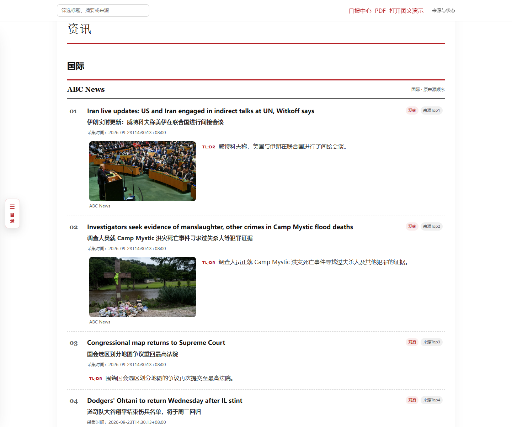
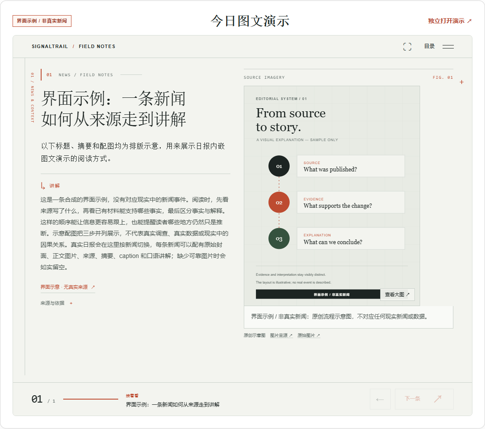
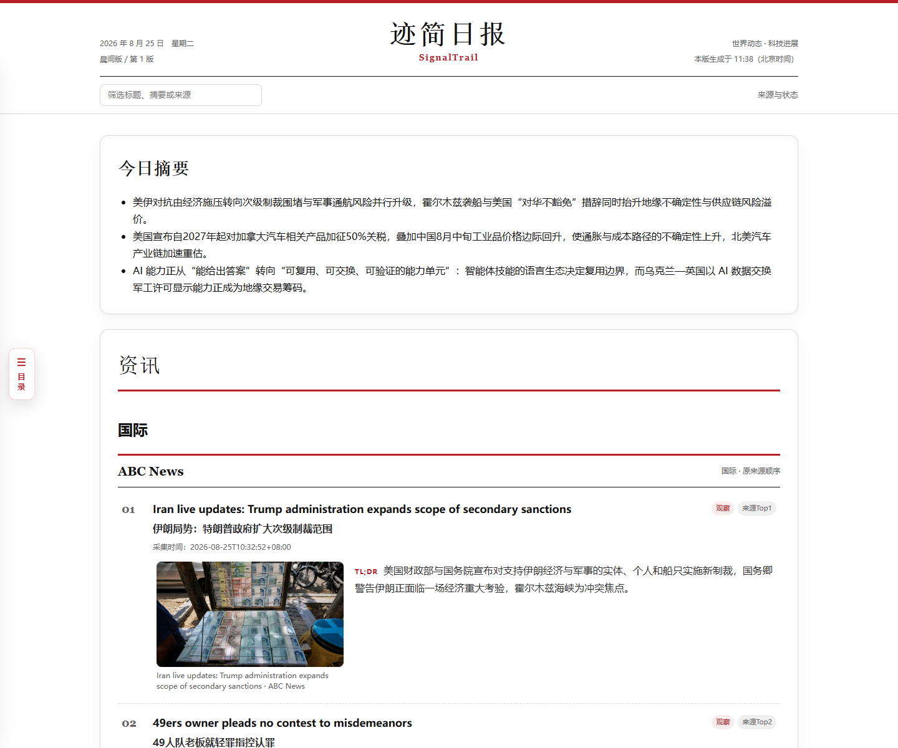
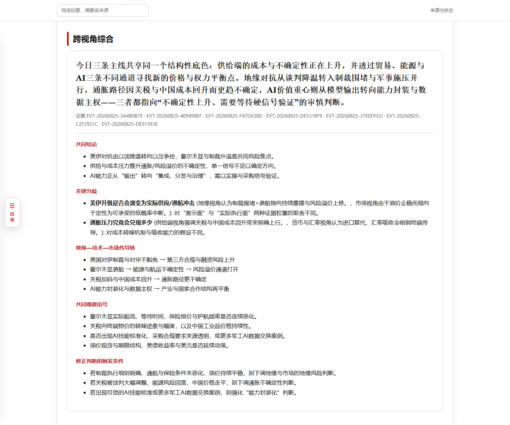
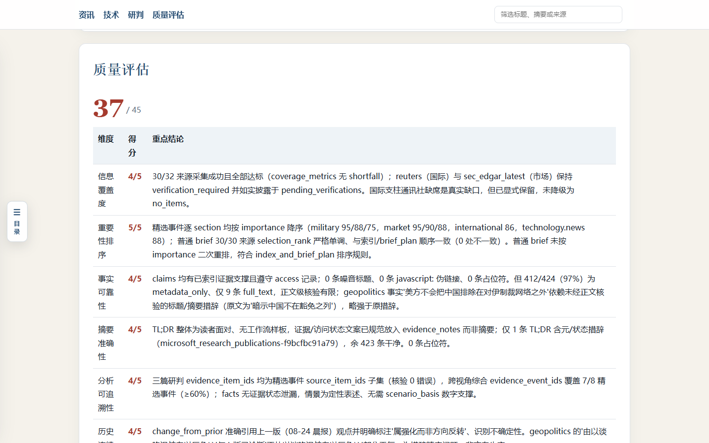
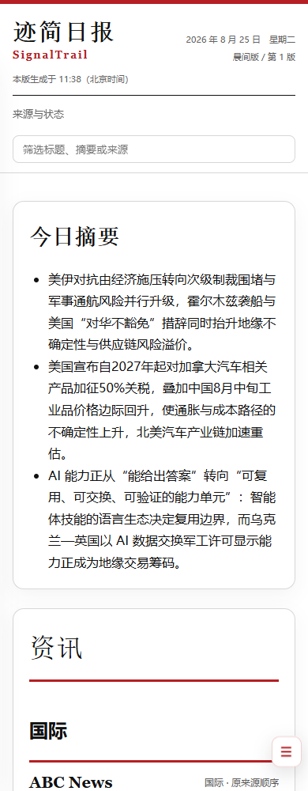

# SignalTrail

[简体中文](README.md) | [English](README.en.md)

SignalTrail is a local news workflow. It collects material from configured public sources, creates source-linked Chinese or English daily reports, and turns each daily edition into a navigable, animated HTML presentation, with an optional locally narrated video. Reports can also be read as HTML, exported to PDF, or optionally sent to Notion.

Python handles collection, evidence and state, validation, and versioned storage. An agent writes from bounded evidence packets. Slide narration uses a conversational, rhythmic presenter voice with light humor, and selects geopolitics, AI/technology, or markets perspectives only when relevant to the story. Chinese narration is 200–350 non-whitespace characters per story. Candidates span the saved report, are deduplicated and ranked by model-authored importance, and default to the top 30. The model reviews recency and duplicate coverage, and excluded stories are replaced by the next candidates. Users can expand the count, with per-batch cost gates.

[Daily report example](#daily-report-example) · [Quick start](#quick-start) · [Animated HTML slides](#animated-html-slides) · [Local monitor](#local-monitor) · [Documentation](docs/README.md) · [Development](docs/development.md)

## What you can do

- **Create daily reports:** collect public sources, write summaries and analysis, save versioned JSON and Markdown, and render local HTML and PDF. The reader works on desktop and mobile.
- **Browse a local news stream:** refresh RSS/Atom and configured static pages, cluster related stories, and inspect source health. Monitor refresh and clustering make no model calls.
- **Build illustrated presentations and video:** each default daily edition includes a visual stream. Optionally export a 1080p narrated video with local Qwen3 TTS and FFmpeg, switch between slides and video in the report, or open the slides independently.
- **Explore related work:** optional experimental explainers and parallel research are documented separately. They are not part of the stable daily news narration workflow.

## Daily report example



The September 23, 2026 morning report contains 415 news items across 30 source groups, three-perspective analysis and cross-perspective synthesis, and an embedded presentation of 41 stories. Download the ZIP, extract it, and open `morning-r1.html` in a browser to read the full report and navigate the presentation. The report HTML is also available separately.

[Download the report and embedded presentation ZIP](https://github.com/Merak-Wang/signaltrail-skill/raw/refs/heads/main/examples/reports/2026-09-23-morning-r1.zip) · [Download the report HTML only](https://github.com/Merak-Wang/signaltrail-skill/raw/refs/heads/main/examples/reports/2026-09-23-morning-r1.html)

For a visual stream without a daily report, collect an index, have the model select the most important items in order, and pass their IDs with repeated `--item-id` options to `signaltrail slides prepare --index INDEX.json --language en --item-id ITEM_ID`. Write only the pending packets and reuse the same submit/status/render commands below. `--reuse-plan OLD_PLAN.json` reuses unchanged accepted writing; unknown usage and costs remain unknown.

## Animated HTML slides



Actual generated presentation: 41 stories from the September 23, 2026 morning report.

[Download the September 23 morning slides HTML](https://github.com/Merak-Wang/signaltrail-skill/raw/refs/heads/main/examples/reports/2026-09-23-morning-r1-slides.html) (open it in a browser after downloading; remote original images may require an internet connection).

Each story occupies one slide. The presenter-style narration appears with the daily summary, sources, and available cover and article images. The gallery prefers clearer image variants, keeps extracted publisher captions, and supports thumbnails, an expanded view, 100% original-size inspection, and a link to the original image. It displays collected material only: images and captions are never invented, and stories without usable images remain without one.

The report’s visual briefing panel switches between slides and video, and the slides can also be opened independently. The video preserves the visual stream’s text, images, and column layout, automatically advancing through pages and images in their original order. Capture scales the whole page by 1.4×. The model writes a concise `video_tldr` from each full narration (60–100 Chinese characters recommended, 160 characters maximum); local Qwen3 TTS reads the title and short script at 1.08× speed, and FFmpeg produces 1080p video. Measured audio duration determines each page’s display time.

Candidates cover the entire saved report: selected events and briefs. Duplicate original stories are merged, then ranked by model-authored importance; the default is the top 30. Set another positive count with `slides prepare --max-news N` or `finalize-edition --slides-max-news N`. There is no per-source quota. Unknown publication dates remain unknown and are never replaced with discovery or collection time. Batches default to five stories and retain estimated input/output size gates. Chinese narration is validated at 200–350 non-whitespace characters. Analysis perspectives are included only when supported by the story evidence.

Start with a saved report and its matching index:

```sh
signaltrail slides prepare --report REPORT.json --index INDEX.json
```

Have the agent write each prepared batch to a JSON file, then submit the results, check progress, and render:

```sh
signaltrail slides submit --packet PACKET.json --input DRAFT.json
signaltrail slides status --plan PLAN.json
signaltrail slides render --plan PLAN.json
```

After all batches are ready, `render` creates the deck HTML and updates the matching report page with its embedded presentation. New installations use the bundled Qwen3 reference voice `neutral-a` (3.33 seconds) by default; existing locally registered voices remain available. To export a video:

```sh
signaltrail --data-dir DATA_DIR slides video-setup
signaltrail --data-dir DATA_DIR slides video --deck DECK.json --output VIDEO.mp4
```

For a custom voice, prepare a 3–10 second recording and exact transcript, complete a profile using [`assets/tts/profile.example.json`](assets/tts/profile.example.json), and run `signaltrail --data-dir DATA_DIR slides voice-setup --profile PROFILE.json --default`. First-time setup downloads the programs, model, browser, and FFmpeg. Later runs can reuse local models and audio caches; `slides render --offline` rebuilds the presentation without fetching images, although remote original images may still require a connection. The default device selection probes GPU synthesis and falls back to CPU when unavailable. See the [news slides guide](docs/news-slides.md) for packets, device options, budgets, and recovery.

## Quick start

You need Python 3.11+, a configured agent, and a local command line; Git is needed when cloning the source. You can clone the repository or download the [SignalTrail 2.1.0 full install package](https://github.com/Merak-Wang/signaltrail-skill/releases/latest).

```sh
git clone https://github.com/Merak-Wang/signaltrail-skill.git
cd signaltrail-skill
python -m pip install -e .
signaltrail --help
```

Load the repository root [`SKILL.md`](SKILL.md) in your agent, then ask for a report, for example:

```text
Use SignalTrail to create today's English daily report as local HTML and PDF.
```

`signaltrail` is the unified CLI. The Python package can be imported as `signaltrail` or launched with `python -m signaltrail.cli`. The CLI prepares reproducible collection, validation, and storage steps; the agent writes from the evidence packets. Running `run-edition` alone stops at the authoring handoff and does not produce a complete report by itself.

### Optional: install for Hermes

Run the matching installer from the repository or extracted full-package root:

```powershell
# Windows
powershell -NoProfile -ExecutionPolicy Bypass -File .\scripts\install.ps1
```

```sh
# macOS / Linux
bash ./scripts/install.sh
```

The scripts synchronize the Skill to Hermes and install the Python command; the SignalTrail CLI itself does not require Hermes. Browser collection on Windows can use system Microsoft Edge. The macOS/Linux installer also installs Playwright Chromium in the same Python environment. For a manual install, run:

```sh
python -m playwright install chromium
```

When upgrading from the earlier package, uninstall the old `daily-intelligence-skill` Python distribution before installing the new version. Keep existing Hermes data and profiles in place and continue using them through explicit data-root and profile settings. See [Upgrade from an earlier version](docs/usage.md#upgrade-from-an-earlier-version) for commands.

See the [usage guide](docs/usage.md) for host setup, data directories, metered runs, and recovery.

## Local monitor

```sh
signaltrail refresh-monitor
signaltrail serve --open --refresh-minutes 30
```

The monitor refreshes sources, organizes the news stream, and clusters related stories without model calls. The server listens on `127.0.0.1` by default and stops refreshing when the process exits. Configure report sources in [`configs/sources.yaml`](configs/sources.yaml) and monitor discovery sources in [`configs/discovery-sources.yaml`](configs/discovery-sources.yaml).

## Data, cost, and boundaries

Versioned report JSON and Markdown are the original records; HTML and PDF are rebuildable reading views. Existing report revisions are not overwritten. Source access failures, rate limits, and verification challenges retain their actual status. Runtime data stays local in an independent SignalTrail application directory by default. Existing users can keep using their current data directory as described in [Upgrade from an earlier version](docs/usage.md#upgrade-from-an-earlier-version), preserving reports and run history.

Collection, monitoring, image handling, and HTML rendering make no model calls. The agent host performs report and slide writing. Batch token gates limit estimated input and output size; actual usage depends on what the host reports. Source availability, network access, evidence coverage, and model latency affect delivery and coverage.

Slides are a separate HTML projection and do not change the report's JSON or Markdown. Every default daily edition requires the visual stream whether usage is metered or unmetered. A report can be saved and delivered before slides finish; `edition-status --run RUN.json --require-complete` is the dynamic gate for full delivery. Local narrated video export is available on request; external platform publishing is not provided. See the [documentation index](docs/README.md) and [roadmap](docs/roadmap.md) for the boundary between experimental explainers/research and the stable report and slides workflow.

## Documentation

- [Usage](docs/usage.md): installation, host, runs, data directory, and recovery.
- [News slides](docs/news-slides.md): narration, images, captions, batch budgets, and rendering.
- [Experimental explainers](docs/explainers.md) and [parallel research](docs/research/2026-09-20-illustrated-workflow.md): experimental workflows and admission limits.
- [Architecture](ARCHITECTURE.md), [development guide](docs/development.md), and [known issues](docs/exec-plans/tech-debt-tracker.md): design and maintenance.
- [Changelog](CHANGELOG.md) · [MIT License](LICENSE)

Earlier report screenshots show the historical reader design, not the current slide presentation:

<details>
<summary>Historical report example and reader screenshots</summary>

[Open a historical HTML example](https://github.com/Merak-Wang/signaltrail-skill/raw/refs/heads/main/examples/reports/2026-08-25-morning-r1.html) in a browser after downloading (some images require internet access). See the [example notes](https://github.com/Merak-Wang/signaltrail-skill/blob/main/examples/README.en.md).









</details>

[简体中文](README.md)
