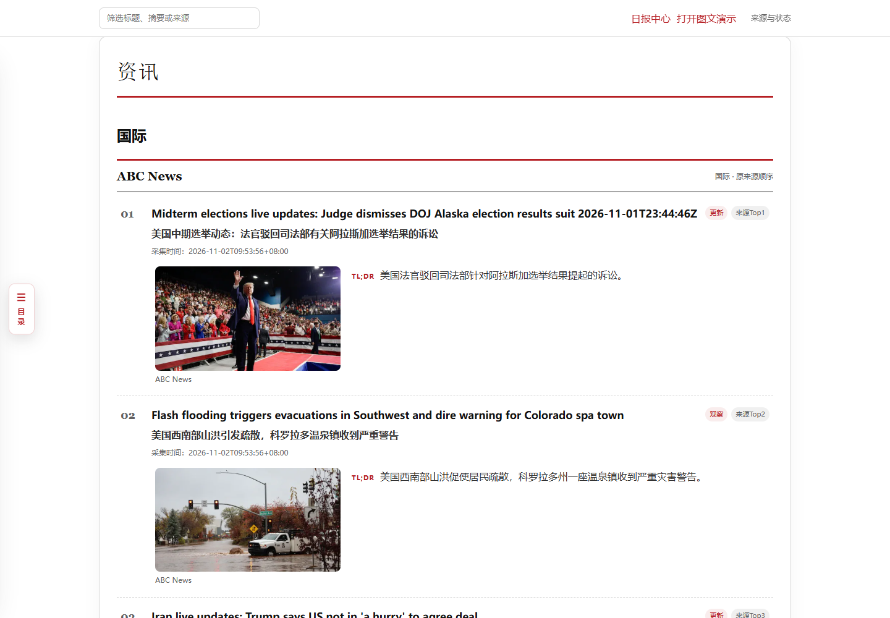

# 迹简情报台 · SignalTrail

[简体中文](README.md) | [English](README.en.md)

SignalTrail 在本机采集公开新闻，由智能体撰写中文或英文日报，并生成图文演示和配音视频。适合每天集中阅读新闻、追踪来源，以及将重点内容整理成可分享的阅读材料。

- **日报：** 汇集新闻摘要与分析，保留原文链接，输出 HTML、PDF、Markdown 和 JSON。
- **图文与视频：** 默认选择最重要的 50 条新闻制作演示，按需使用本地 Qwen3-TTS 导出 1080p 配音视频；也可直接从采集索引制作。
- **采集监控：** 查看新闻、事件聚类和来源健康，通过配置文件扩展来源。

## 最新样例

2026 年 11 月 2 日生成的中文日报，图文演示与视频包含 50 条新闻，视频时长 16 分 11 秒。点击封面下载视频：

[](https://github.com/Merak-Wang/signaltrail-skill/raw/refs/heads/main/examples/reports/2026-11-02-daily-r1-video.mp4)

[下载配音视频 MP4](https://github.com/Merak-Wang/signaltrail-skill/raw/refs/heads/main/examples/reports/2026-11-02-daily-r1-video.mp4) · [下载日报与图文演示 ZIP](https://github.com/Merak-Wang/signaltrail-skill/raw/refs/heads/main/examples/reports/2026-11-02-daily-r1.zip) · [下载独立图文 HTML](https://github.com/Merak-Wang/signaltrail-skill/raw/refs/heads/main/examples/reports/2026-11-02-daily-r1-slides.html)

ZIP 解压后打开 `2026-11-02-daily-r1.html`。将 MP4 下载到同一目录，即可在日报内切换图文演示与视频。



## 快速开始

需要 Python 3.11+、Git，以及一个已配置模型、可读写文件和运行命令的智能体。

```sh
git clone https://github.com/Merak-Wang/signaltrail-skill.git
cd signaltrail-skill
python -m pip install -e .
python -m playwright install chromium
signaltrail --help
```

在智能体中加载仓库根目录的 [SKILL.md](SKILL.md)，然后提出需求：

```text
使用 SignalTrail 生成今天的中文日报，包含图文演示和配音视频，
将 HTML、PDF 和视频保存到本地。
```

智能体负责选题与写作，CLI 负责采集、渲染和存档。也可以只要求：

```text
采集今天的新闻，选择最重要的 50 条，制作中文图文演示和配音视频。
```

首次视频准备会下载运行程序和模型，后续复用本地缓存。完整安装、数据目录与恢复步骤见[使用指南](docs/zh-CN/usage.md)。

## 配置与文档

默认输出中文，可要求英文或设置 `output.language: en`。在 [sources.yaml](configs/sources.yaml) 调整核心来源，在 [discovery-sources.yaml](configs/discovery-sources.yaml) 调整扩展来源；两份配置中的启用项均按现有栏目进入日报，收录各来源全部合格当日新闻并保留来源Top。

| 文档 | 内容 |
| --- | --- |
| [使用指南](docs/zh-CN/usage.md) | 安装、语言、数据目录、宿主用量和恢复 |
| [图文与视频](docs/zh-CN/news-slides.md) | 日报与独立索引两种路径、渲染、配音和自定义音色 |
| [采集扩展](docs/zh-CN/platform.md) | 本地监控、RSSHub、Crawl4AI 和事件档案 |
| [开发指南](docs/zh-CN/development.md) · [架构](docs/zh-CN/ARCHITECTURE.md) | 代码结构、维护约定和检查 |
| [文档索引](docs/zh-CN/README.md) · [变更记录](CHANGELOG.md) | 其他指南与版本历史 |

## 许可

[MIT License](LICENSE)。可选 Crawl4AI 正文抽取集成署名：

This product includes software developed by UncleCode (https://x.com/unclecode) as part of the Crawl4AI project (https://github.com/unclecode/crawl4ai).
